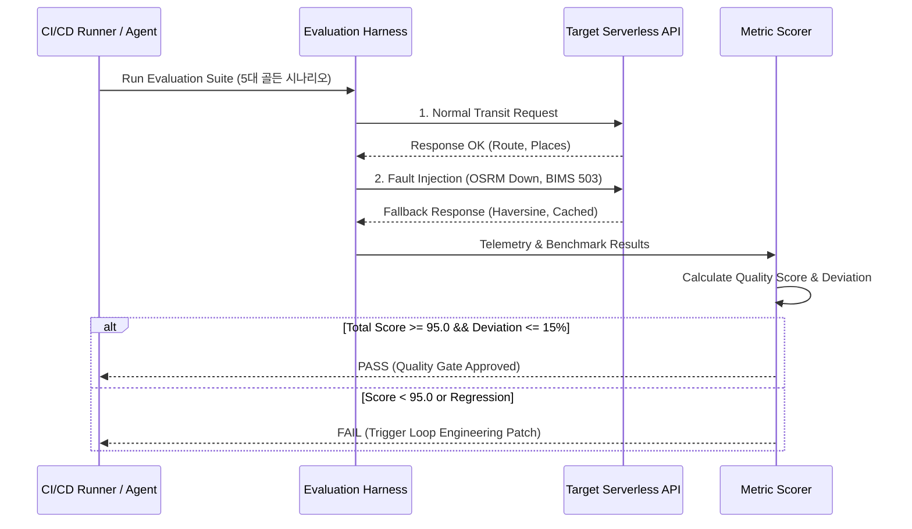

# 🧪 Evaluation Loop & Benchmark Specification (평가 루프 및 벤치마크 시나리오)

본 문서는 **부산 버스·지하철 스마트 도착 비서 및 중간지점 약속 플랫폼**의 자율 피드백 루프에서 실행되는 **하네스 기반 자동 평가 루프(Evaluation Loop)**와 **벤치마크 테스트 시나리오**를 정의합니다.

---

## 1. 평가 루프 프레임워크 개요

평가 루프는 코드의 수정이나 모델/알고리즘의 변경이 일어날 때마다 자동으로 구동되며, 사전 정의된 골든 데이터셋(Golden Dataset)과 스트레스 시나리오를 통해 시스템의 **정확성, 복원력, 성능**을 객관적으로 채점합니다.



---

## 2. 5대 핵심 벤치마크 시나리오 (Golden Benchmark Suite)

### 시나리오 1: 대연역 ➔ 부산역 경로 정밀도 평가
- **목적**: 대연역에서 부산역 간 지하철(2호선 서면역 환승 ➔ 1호선 부산역) 및 버스 경로의 지오메트리 왜곡 여부 검증.
- **입력**:
  - `start`: 35.1378, 129.0924 (대연역)
  - `end`: 35.1152, 129.0422 (부산역)
- **통과 기준**:
  - 총 소요 시간 추정치: 20분 ~ 30분 이내
  - 경로 지오메트리 포인트 수: 최소 15개 이상의 정확한 웨이포인트 포함
  - 이상 경로(우회 경로 또는 바다 횡단) 탐지 시 즉시 Fail.

### 시나리오 2: 양정역 ➔ 해운대 모드 분기 및 교통 시각화 평가
- **목적**: 버스 모드와 지하철 모드의 경로 분기 및 실시간 교통 상황 레이어의 정합성 검증.
- **입력**:
  - `start`: 35.1729, 129.0712 (양정역)
  - `end`: 35.1631, 129.1636 (해운대역)
- **통과 기준**:
  - 지하철 모드: 1호선 양정 ➔ 서면 환승 ➔ 2호선 해운대 경로 정확도 100%
  - 버스 모드: 간선버스(예: 31번, 141번) 노선 지오메트리 반영
  - 지도상 컬러코드(원활-초록, 서행-주황, 지체-빨강) 트래픽 레벨 표출 검증.

### 시나리오 3: N인 약속 중간지점 공평성(Fairness) 최소 편차 검증
- **목적**: 3개 극단 지역(노포역, 다대포해수욕장역, 장산역) 거주자의 공평한 중간역 도출.
- **입력**:
  - Participant A: 35.2846, 129.0949 (노포역)
  - Participant B: 35.0478, 128.9663 (다대포해수욕장역)
  - Participant C: 35.1699, 129.1768 (장산역)
- **통과 기준**:
  - 추천 중간역: **서면역** 또는 **동래역** (환승 결절점)
  - 각 참가자 간 이동 시간 표준편차: $\sigma \le 12\text{분}$
  - 공평성 지수(Fairness Index) $\ge 90\%$.

### 시나리오 4: 네이버 지도 스타일 장소/메뉴 46개소 무결성 검증
- **목적**: 부산 5대 상권 46개 맛집/카페의 상세 데이터 스키마 무결성 평가.
- **검증 항목**:
  - `signatureMenu`가 빈 문자열이 아니어야 함.
  - `menuList` 항목이 최소 3개 이상이어야 하며, 모든 메뉴는 정수형 가격(`price > 0`)을 가져야 함.
  - `businessHours`, `phone`, `moodTags`가 온전하게 채워져 있어야 함.
  - 임의 스톡 이미지 대신 브랜드 상권 표지 플레이트가 올바르게 매핑되어 있어야 함.
- **통과 기준**: 46개 데이터 세트 전수 검사 결함 0건 (100% Pass).

### 시나리오 5: 외부 API 결함 주입 (Fault Injection) 및 자가 복구 평가
- **목적**: OSRM 서버 다운 및 공공데이터 포털 500 에러 발생 시의 폴백 생존성 검증.
- **결함 주입 조건**:
  - OSRM HTTP 호출 시 강제 `Connection Timeout (3000ms)` 또는 `HTTP 500` 반환.
  - BIMS 공공데이터 포털 호출 시 `HTTP 503 Service Unavailable` 주입.
- **통과 기준**:
  - 클라이언트에 HTTP 500 에러 노출 0건.
  - Haversine 폴백 경로 50ms 이내 정상 반환.
  - 서킷 브레이커 트립 및 에러 텔레메트리 정상 로깅.

---

## 3. 평가 메트릭 산출 공식

$$
\text{Total Evaluation Score} = w_1 \cdot S_{\text{accuracy}} + w_2 \cdot S_{\text{fairness}} + w_3 \cdot S_{\text{resilience}} + w_4 \cdot S_{\text{latency}}
$$

- $w_1 = 0.35$ (경로 및 장소 데이터 정밀도)
- $w_2 = 0.25$ (중간지점 공평성 지수)
- $w_3 = 0.25$ (장애 주입 시 폴백 생존율)
- $w_4 = 0.15$ (응답 지연 SLA 달성률)

**합격 기준**: Total Score $\ge 95.0$ / 100.0

---

## 4. 자동 평가 실행 명령어 규격

루프 엔지니어링 실행 파이프라인에서 아래 명령어로 평가 루프를 직접 호출할 수 있습니다.

```bash
# 1. L1~L4 하네스 단위/통합 테스트 일괄 실행
mvn test -Dtest=*Harness*

# 2. 5대 골든 벤치마크 시나리오 E2E 평가 실행
mvn test -Dtest=GoldenBenchmarkEvaluationSuite

# 3. 결함 주입 생존성 스트레스 평가
mvn test -Dtest=FaultInjectionResilienceEvaluation
```
