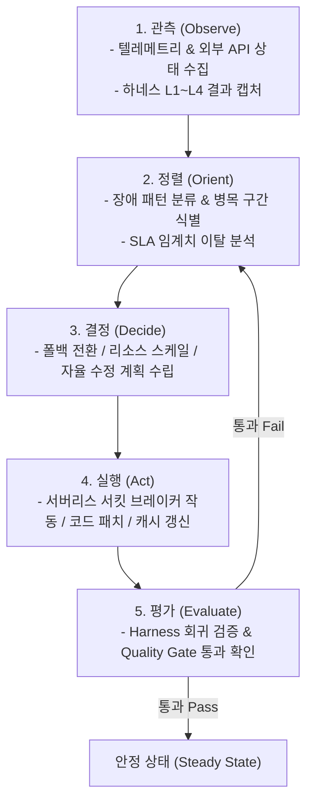

# 🔄 Loop Engineering (루프 엔지니어링) 프레임워크 명세서

본 문서는 **부산 버스·지하철 스마트 도착 비서 및 중간지점 약속 플랫폼**을 서버리스 환경에서 자율적이고 지속 가능한 무정지 시스템으로 유지하기 위한 **루프 엔지니어링(Loop Engineering)** 아키텍처 및 자율 피드백 사이클을 정의합니다.

---

## 1. 개요 및 루프 철학

루프 엔지니어링은 전통적인 일회성 배포(Fire-and-Forget) 방식을 지양하고, **[관측 ➔ 정렬 ➔ 결정 ➔ 실행 ➔ 평가]**의 피드백 루프를 시스템 전 주기에 걸쳐 코드화(As-Code)하는 엔지니어링 방법론입니다.



---

## 2. 자율 피드백 루프 (Autonomous Feedback Loop)

### 2.1 OODA 기반 엔지니어링 사이클

| 단계 | 실행 주체 | 대상 컴포넌트 | 세부 역할 |
| :--- | :--- | :--- | :--- |
| **Observe (관측)** | Edge Telemetry Collector | Cloudflare Workers / AWS Lambda | OSRM/BIMS 응답 지연(Latency), 에러율(5xx), 계약 위반 건수 실시간 수집 |
| **Orient (정렬)** | Harness Log Analyzer | Evaluation Engine | 발생한 오류가 외부 공급자 일시 다운인지, 스키마 변형인지, 메모리 초과인지 분류 |
| **Decide (결정)** | Self-Healing Controller | Orchestrator | OSRM ➔ Haversine 폴백 결정, 서킷 오픈, 자동 캐시 TTL 연장, 또는 프롬프트 기반 코드 수정 지시 |
| **Act (실행)** | Serverless Actuator | Edge Router & Functions | 서킷 브레이커 트립, 정적 지오메트리 서빙 전환, 환경변수 갱신, 패치 브랜치 핫픽스 배포 |
| **Evaluate (평가)** | Automated Harness Runner | GitHub Actions / Edge Test Runner | `HARNESS.md`에 명시된 L1~L4 하네스를 즉시 실행하여 수렴 여부 판정 |

---

## 3. 4대 핵심 루프(Core Loops) 상세 설계

### Loop 1: 실시간 런타임 자가 치유 루프 (Runtime Self-Healing Loop)
- **주기**: 연속 (밀리초 단위 이벤트 트리거)
- **트리거**:
  - OSRM 도로망 라우팅 API 500ms 초과 또는 3회 연속 실패
  - 부산시 BIMS 공공데이터 포털 503 Service Unavailable
- **동작 루프**:
  1. 서킷 브레이커 상태를 `HALF-OPEN` ➔ `OPEN`으로 전환.
  2. 요청을 즉각 `Haversine + 실존 역간 고정 보정 알고리즘`으로 우회.
  3. 클라이언트에게 경고 플래그(`"source": "fallback-haversine"`)와 함께 50ms 이내 응답 반환.
  4. 30초 후 Background Probe 요청을 1건 전송하여 정상화 감지 시 서킷 `CLOSED`로 복구.

### Loop 2: 데이터 정합성 & 검증 루프 (Data Integrity Loop)
- **주기**: 매 1시간 주기 (Edge Scheduled Cron)
- **트리거**: 부산 맛집/카페 플레이스 데이터 및 지하철역 좌표
- **동작 루프**:
  1. 46개 핵심 권역 맛집의 메뉴 가격 및 영업시간 스키마 검증.
  2. 좌표(Latitude/Longitude)가 부산시 경계(35.0°N ~ 35.4°N, 128.8°E ~ 129.3°E) 내에 존재하는지 검사.
  3. 누락된 메뉴 또는 비정상 가격 발견 시 직전 정상 캐시(KV Store Snapshot)로 롤백 및 알림 발행.

### Loop 3: 코드 변경 및 자율 수정 루프 (Agentic Code Mutation Loop)
- **주기**: 커밋/PR 발생 시 또는 버그 리포트 트리거
- **트리거**: 사용자의 새로운 요구사항(예: 네이버 지도 UI 연동, OSRM 대체, 경로 버그 수정)
- **동작 루프**:
  1. **Failure Capture**: 사용자가 지적한 버그 재현 시나리오를 L2/L3 하네스 테스트 코드로 생성.
  2. **Code Patch**: 에이전트가 코드를 수정(TypeScript/Java).
  3. **Harness Execution**: 전체 하네스 슈트 자동 구동.
  4. **Loop Exit / Retry**:
     - 하네스 전체 통과 시 ➔ Git 커밋 및 배포.
     - 실패 시 ➔ 실패 스택 트레이스를 다시 입력으로 주입하여 최대 3회 재수정 반복.

### Loop 4: 성능 및 콜드스타트 최적화 루프 (Performance Optimization Loop)
- **주기**: 일일(Daily) 벤치마크
- **트리거**: P99 응답 시간 > 100ms
- **동작 루프**:
  1. Edge Functions의 번들 사이즈(Bundle Size) 측정 (< 1MB 유지).
  2. 서버리스 콜드스타트 지연 시간 프로파일링.
  3. 고빈도 호출 경로(서면, 부산역, 해운대)에 대해 Edge KV 캐시 Pre-warming 수행.

---

## 4. 품질 게이트 (Quality Gates) 및 통과 기준

루프가 종료되고 배포 단계로 전이되기 위해서는 아래의 4가지 품질 게이트를 **100% 무결성**으로 통과해야 합니다.

```
+-----------------------------------------------------------------------+
|                         QUALITY GATE PIPELINE                         |
+-----------------------------------------------------------------------+
     │
     ▼
[Gate 1: Contract Validation]  --> JSON Schema 100% 일치 (Zero Error)
     │
     ▼
[Gate 2: Fault Tolerance]     --> OSRM/BIMS 100% 장애 시에도 에러율 0% (Fallback)
     │
     ▼
[Gate 3: Performance SLA]      --> Fallback 응답 < 20ms, 정상 응답 < 100ms
     │
     ▼
[Gate 4: Route Accuracy]       --> 중간지점 오차 편차 σ < 15% 이내 수렴
     │
     ▼
[STATUS: PRODUCTION DEPLOYABLE]
```

---

## 5. 루프 종료 조건 (Termination Criteria)

무한 루프 방지 및 안전한 운영을 위한 강제 수렴 규칙:

1. **Max Retry Limit**: 단일 버그 패치 루프는 최대 5회까지만 시도하며, 5회 초과 시 직전 안정 빌드로 즉시 롤백하고 인간 엔지니어 호출.
2. **Regression Guard**: 기존에 통과하던 벤치마크 케이스(예: 대연역 ➔ 부산역, 양정역 ➔ 해운대) 중 단 1건이라도 실패할 경우 패치 거부.
3. **Flaky Test Rejection**: 동일 환경에서 3회 연속 성공한 경우에만 최종 통과로 인정.
