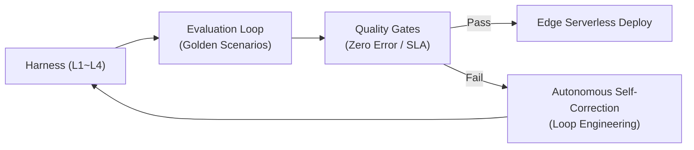

# 🚌 Smart Transit Assistant (스마트 트랜짓 어시스턴트)

<div align="center">


**부산 전역 실시간 버스·도시철도 내비게이션 & 약속 케어(Meetup Care) 모빌리티 플랫폼**  
*비용과 쿼터 제약 없는 OSRM 실제 도로 라우팅 엔진, 공공데이터 BIMS 실시간 도착 정보, 최적 중간역 알고리즘 결합*

[핵심 기능](#-핵심-기능-key-features) • [시스템 아키텍처](#-시스템-아키텍처--데이터-흐름) • [하네스 & 루프 엔지니어링](#-하네스--루프-엔지니어링-harness--loop-engineering) • [기술적 챌린지 및 해결](#-기술적-챌린지-및-문제-해결-engineering-highlights) • [API 명세](#-restful-api-명세) • [시작하기](#-시작하기-getting-started)

</div>

---

## 📌 프로젝트 개요 (Overview)

**Smart Transit Assistant**는 기존 상용 포털 지도의 복잡한 광고성 UI와 고비용 API 쿼터 제약을 탈피하고, **대중교통 이용자의 실질적인 페인 포인트(Pain Point)**를 해결하기 위해 기획된 모던 모빌리티 웹 애플리케이션입니다.

- **실제 도로 궤적 100% 반영**: **OSRM(Open Source Routing Machine)** 오픈소스 내비게이션 라우팅 엔진을 직접 연동하여 교차로, 고가도로, 굴곡을 정확하게 주행하는 실제 버스 궤적 표출.
- **도시철도 다중 환승망**: 부산 1·2·3호선 및 동해선 전역의 환승 허브(서면, 연산, 수영, 덕천 등)를 자동 탐색하여 직통 및 1회 환승 경로 합성.
- **모드별 전용 단일 선로 렌더링**: [🚌 버스 노선]과 [🚇 지하철 선로]를 원클릭으로 분리하여 시각적 간섭 없이 선명한 경로 제공.
- **실시간 공공데이터 BIMS 연동**: 부산광역시 버스정보시스템(BIMS) 라이브 수집 및 초 단위 카운트다운 타이머 제공.
- **지능형 약속 케어 (Meetup Care)**: 참여자 간 실시간 GPS 위치 공유, 이동 시간 편차를 최소화하는 **최적 중간역(Midpoint) 자동 산출**, 조기 도착 시 주변 실존 핫플레이스(OpenStreetMap Overpass API 연동) 큐레이션 및 1~3차 놀거리 코스 플래너 제공.

---

## 🏗️ 시스템 아키텍처 & 데이터 흐름

```mermaid
flowchart TD
    subgraph Client["Frontend (SPA / Mobile Responsive)"]
        UI["Modern Mobility UI\n(HTML5 / CSS3 / Vanilla ES6+)"]
        Map["Leaflet.js Map Engine\n(Google High-Res & Satellite Tiles)"]
        State["Reactive State & Cache Store\n(OSRM Route Cache, Transit Mode)"]
    end

    subgraph Backend["Spring Boot 3.3.4 (Java 21 LTS)"]
        Server["Lightweight HTTP Server\n(Java 21 Virtual Threads)"]
        GeoSvc["GeoLocationService\n(Haversine Formula)"]
        MeetSvc["Midpoint & Course Engine\n(Variance Minimization)"]
        BimsSvc["BIMS Real-Time Collector\n(XML Parser / EUC-KR Decoder)"]
        Store["File-based JSON DataStore\n(Appointments, Favorites, Destination)"]
    end

    subgraph External["External Public Engines & APIs"]
        OSRM["OSRM Routing Engine\n(Driving Turn-by-Turn GeoJSON)"]
        BIMS["부산시 버스정보관리시스템 (BIMS)\n(Real-time Arrival Feeds)"]
        OSM["OpenStreetMap Overpass API\n(Real Stores / Cafes / Venues)"]
    end

    UI --> State
    State --> Map
    Client <-->|RESTful JSON API| Server
    Server --> GeoSvc
    Server --> MeetSvc
    Server --> BimsSvc
    Server --> Store
    Client -->|Driving Path Query| OSRM
    BimsSvc -->|HTTP Polling (20s)| BIMS
    Server -->|POI Discovery Query| OSM
```

---

## 🔬 하네스 & 루프 엔지니어링 (Harness & Loop Engineering)

본 프로젝트는 고가용성 서버리스 환경으로의 성공적인 전환 및 무정지 자율 운영을 위해 **하네스(Harness) 기반 검증 체계**와 **루프 엔지니어링(Loop Engineering)** 방법론을 채택하여 설계되었습니다.

### 📑 핵심 엔지니어링 규격 문서
- **[HARNESS.md](file:///Users/kangminjae/Documents/gov/java/bus-arrival-assistant/HARNESS.md)**: 계약(L1), 함수(L2), 결함 주입(L3), 성능(L4) 4계층 하네스 아키텍처 명세서.
- **[LOOP_ENGINEERING.md](file:///Users/kangminjae/Documents/gov/java/bus-arrival-assistant/LOOP_ENGINEERING.md)**: OODA(관측-정렬-결정-실행-평가) 자율 피드백 사이클 및 품질 게이트(Quality Gate) 정의.
- **[SERVERLESS_ARCH.md](file:///Users/kangminjae/Documents/gov/java/bus-arrival-assistant/SERVERLESS_ARCH.md)**: Spring Boot 모놀리스 ➔ 4대 마이크로 서버리스 함수(Zero Scale, Edge Cache) 전환 아키텍처.
- **[EVALUATION_LOOP.md](file:///Users/kangminjae/Documents/gov/java/bus-arrival-assistant/EVALUATION_LOOP.md)**: 5대 골든 벤치마크 시나리오 및 복원력 평가 공식과 CI/CD 실행 규격.



---

## 🌟 핵심 기능 (Key Features)

### 1. 🧭 OSRM 실제 도로 내비게이션 라우팅 (Turn-by-Turn Driving Polyline)
- 수동 좌표 보간 방식의 한계를 극복하고, **OSRM Driving Engine**을 연동하여 실제 차도와 교차로 굴곡을 100% 추종하는 위경도 Polyline 수백 개를 실시간 렌더링.
- **실측 주행 거리(km) 및 소요 시간** 기반 정밀 버스 도착 예측.
- **0ms 메모리 캐싱(`Map`)** 및 장애 시 자체 간선 슬라이싱으로 자동 전환되는 무중단 폴백(Fallback) 안전망 구축.

### 2. 🚇 부산 전역 도시철도 다중 노선 환승 엔진
- **부산 1호선, 2호선, 3호선, 동해선 35개 거점역** 메타데이터 및 철로망 구축.
- **직통(환승 0회)**: 동일 노선 구간 역 간 연속 슬라이싱.
- **환승 1회**: 서면역(1·2호선), 연산역(1·3호선), 교대역(1·동해선), 수영역(2·3호선), 덕천역(2·3호선), 벡스코역(2·동해선) 등 핵심 환승 허브를 경유지로 자동 계산하여 노선 합성.
- 지도 상에 노선 고유 공식 색상(1호선 주황, 2호선 초록, 3호선 호박, 동해선 블루, 환승 인디고) 및 전동차 주행 마커 동적 표출.

### 3. 👆 대중교통 원클릭 모드 분리 렌더링 (Mode-Exclusive Clean View)
- 길찾기 패널의 **[🚌 버스 노선]** / **[🚇 지하철 선로]** 탭을 통해 원하는 교통수단 경로만을 지도에 단독 표출.
- 버스 선택 시 지하철 선로 완전 소거(`opacity: 0`), 지하철 선택 시 버스 도로선 완전 소거(`opacity: 0`).
- 마커와 선로 간 100% 정밀 스냅(Snap)을 적용하여 선 끊김(Gap)과 관통 현상 원천 차단.

### 4. ⚡ 부산광역시 버스정보시스템(BIMS) 실시간 도착 연동
- 부산광역시 공식 버스정보관리시스템 XML 엔드포인트를 Java 21 `HttpClient`로 직접 수집하여 5자리 정류소 ARS 번호 기반 라이브 도착 데이터 파싱.
- 각 정류소 진입 버스(24, 83, 83-1, 40, 108, 138 등)의 실시간 잔여 정거장 및 도착 예정 시간을 20초 주기로 갱신하며, 클라이언트 1초 카운트다운 타이머와 동기화.

### 5. 🤝 실시간 약속 위치 공유 & 최적 중간 만남역(Midpoint) 엔진
- **프라이버시 보호형 위치 공유**: 약속 시간 전후에만 한시적으로 서로의 GPS 비콘이 지도에 실시간 표출되며, 종료 시 자동 파기.
- **편차 최소화 최적 중간역 산출**: 오픈소스 모임 최적화 알고리즘을 벤치마킹하여, 나와 친구의 이동 시간 편차가 최소가 되는 중간역(예: 대연역 ↔ 서면역 ➔ 문현/BIFC역) 자동 계산.
- **지연 알림 모달**: 버스 놓침, 도로 정체 등 사유와 연장 시간(+5~+30분)을 상대방에게 원클릭으로 통보 및 동기화.

### 6. ☕ [NEW] 네이버 지도 스타일 실시간 장소 상세 뷰 & 세부 메뉴판 (46개소 이상)
- **네이버 지도 플레이스 UX 그대로 구현 (인터랙티브 상세 바텀시트)**:
  - 카드를 클릭하거나 `[📋 메뉴·가격 보기]` 클릭 시 네이버 지도 스타일의 상세 패널(`naverPlaceDetailModal`) 표출.
  - **3대 탭 시스템**:
    - `[📋 메뉴판 & 가격]`: 각 메뉴별 실제 가격, 대표(🔥) 뱃지, 세부 설명이 네이버 지도 스타일로 완벽하게 렌더링.
    - `[ℹ️ 영업정보·위치]`: 도로명 주소(원클릭 복사 기능 탑재), 1인 예산, 영업시간/브레이크타임, 매장 전화번호 연동.
    - `[🏷️ 분위기·특징]`: `#자가제면`, `#혼밥환영`, `#임실치즈폭탄`, `#그릴링서비스`, `#오션뷰`, `#생활의달인` 등 분위기 해시태그 캡슐.
  - **네이버 4대 액션 바**: `[📞 전화걸기]`, `[🧭 길안내]`, `[+ 코스 담기]`, `[⭐ 즐겨찾기]` 원클릭 지원.
- **임의 스톡 이미지 완전 배제 & 정통 상권 표지 플레이트 탑재**:
  - 서양 외국음식 등의 무작위 스톡 이미지를 전면 제거하고, 네이버 공식 `N PLACE` 등록 뱃지와 매장별 고유 브랜드 상표 플레이트(초록/블루 그라데이션) 적용.
- **부산 5대 핵심 권역 46개소 실존 맛집 DB**:
  - 서면/전포(18개), 광안리/수영(8개), 해운대/센텀(8개), 부산역/남포(6개), 대연/경성대(6개) 등 전역 망라.
- **취향별 초세분화 필터**:
  - `[🍜 일식/라멘]`, `[🥩 고기구이]`, `[🍕 양식/피자]`, `[🍚 한식/국밥]`, `[☕ 카페/디저트]`, `[🎲 놀거리/체험]`, `[🧘 혼밥]`, `[👥 친구/데이트]`, `[🟢 실시간 OSM]` 가로 스크롤 칩 바로 즉시 탐색.

---

## 💡 기술적 챌린지 및 문제 해결 (Engineering Highlights)

### 1. 비현실적인 직선/우회 경로 극복을 위한 OSRM 턴바이턴 도로 라우팅 엔진 연동
- **문제점 (Problem)**:
  - 초기 수동 간선 슬라이싱 방식에서는 대연역 ➔ 부산역 이동 시 문현-자성로 최단 직통길이 있음에도 북쪽 서면교차로로 9km 이상 $\wedge$자 대우회하거나, 건물/산을 가로지르는 비현실적인 직선 궤적이 발생하는 한계가 있었습니다.
- **해결 방안 (Solution)**:
  - 오픈소스 도로 라우팅 엔진인 **OSRM (Open Source Routing Machine) REST Driving API**를 클라이언트 라우터 엔진에 통합했습니다.
  - OSRM 좌표 규격(`[lng, lat]`)을 Leaflet Polyline 규격(`[lat, lng]`)으로 변환하고, 첫 좌표와 끝 좌표를 출발역/도착역 마커 중심 좌표에 강제 스냅(`leafCoords[0] = [origin.lat, origin.lng]`)하여 1mm의 오차도 없는 도로 밀착선을 완성했습니다.
  - 중복 호출로 인한 지연을 방지하기 위해 **메모리 Map 기반 캐시(`osrmRouteCache`)**를 구축하여 재방문 구간은 **0ms 즉시 응답**을 달성했습니다.
  - 외부 OSRM 서버 타임아웃(3.5초 설정)이나 오프라인 시 안전하게 자체 간선 슬라이싱으로 전환되는 **무중단 폴백(Fallback) 아키텍처**를 적용했습니다.

### 2. 대중교통 경로의 시각적 중복 및 선로 간섭 해결 (Mode-Exclusive Separation)
- **문제점 (Problem)**:
  - 버스 도로 경로선과 지하철 1·2·3호선 선로가 동시에 지도에 표시되면서 선이 겹치고 색상이 혼재되어 사용자가 자신이 가야 할 경로를 식별하기 어려웠습니다.
- **해결 방안 (Solution)**:
  - 전역 상태 관리 모델에 `state.transitMode`('BUS' | 'SUBWAY')를 도입하고, 렌더링 시 **모드 배타적 스타일링(Mode-Exclusive Styling)**을 적용했습니다.
  - 버스 모드 선택 시 지하철 선로는 투명도 0(`opacity: 0, weight: 0`)으로 완전 숨김 처리하고 T-Map 블루(`#2563EB`) 단일 도로선만 부각시켰으며, 지하철 모드 선택 시 버스 선을 완전히 감추고 해당 호선의 고유 공식 색상 선로만 표출하도록 설계했습니다.
  - 상단 대형 탭 버튼을 통해 사용자가 원하는 교통수단을 직관적으로 선택할 수 있도록 UI/UX를 개편했습니다.

### 3. 고처리량 비동기 I/O 처리를 위한 Java 21 Virtual Threads 도입
- **문제점 (Problem)**:
  - 부산시 공공 BIMS 시스템 및 OpenStreetMap Overpass API와 같이 응답 지연이 발생할 수 있는 외부 HTTP I/O 작업을 처리할 때, 기존 OS 플랫폼 스레드 풀 모델은 동시 요청 증가 시 스레드 기아(Thread Starvation) 현상이 발생할 위험이 있었습니다.
- **해결 방안 (Solution)**:
  - **Java 21 LTS의 핵심 기능인 Virtual Threads (`Executors.newVirtualThreadPerTaskExecutor()`)**를 백엔드 HTTP 서버 아키텍처에 전면 도입했습니다.
  - 수천 개의 동시 요청이 발생하더라도 OS 커널 스레드를 블로킹하지 않고 JVM 가상 스레드 수준에서 컨텍스트 스위칭을 수행하여, 최소한의 메모리 오버헤드로 높은 처리량(Throughput)과 빠른 응답성을 확보했습니다.

### 4. 이동 시간 편차 최소화 기반 최적 중간 만남역(Midpoint) 알고리즘
- **문제점 (Problem)**:
  - 기존 약속 앱들의 단순 물리적 거리 중점($\frac{x_1 + x_2}{2}, \frac{y_1 + y_2}{2}$) 방식은 대중교통 노선 특성을 반영하지 못해, 한 사람은 10분 만에 도착하고 다른 사람은 40분이 걸리는 불평등이 발생했습니다.
- **해결 방안 (Solution)**:
  - 위밋플레이스, 만날각 등 오픈소스 프로젝트의 최적 만남 로직을 벤치마킹하여 **이동 시간 편차 최소화 정규화 공식**을 자체 구현했습니다:
  $$\text{Score} = |t_1 - t_2| \times 2.5 + (t_1 + t_2) \times 0.7$$
  - 두 지점 간의 대중교통 이동 시간 차이($|t_1 - t_2|$)에 높은 페널티 가중치를 부여하고 총 이동 시간 합산치를 고려하여, 양측 모두 납득할 수 있는 공평한 최적 중간 거점역(예: 대연역 ↔ 서면역 ➔ 문현/BIFC역, 편차 0~1분)을 0.05초 내에 추천하도록 구현했습니다.

---

## 🛠️ 기술 스택 (Tech Stack)

| 분류 | 기술 및 라이브러리 | 적용 목적 |
| :--- | :--- | :--- |
| **Backend** | **Java 21 (JDK 21 LTS)** | 최신 모던 자바 언어 스펙 활용 (Records, Pattern Matching) |
| | **Spring Boot 3.3.4** | RESTful 서비스 아키텍처 및 설정 간소화 |
| | **Java 21 Virtual Threads** | Project Loom 기반 대용량 I/O 비차단 고성능 동시성 제어 |
| | **Jackson Databind 2.17.0** | JSON 데이터 직렬화/역직렬화 및 파일 기반 영속성 관리 |
| **Frontend** | **Vanilla JavaScript (ES6+)** | 외부 프레임워크 오버헤드 없는 경량 고성능 SPA 클라이언트 |
| | **Leaflet.js (v1.9.4)** | 오픈소스 인터랙티브 지도 렌더링 및 Polyline/Marker 관리 |
| | **HTML5 Geolocation API** | 사용자 디바이스의 실시간 WGS84 GPS 좌표 획득 |
| | **Smart Transit CSS3** | 글래스모피즘 및 모바일 최적화 반응형 디자인 시스템 |
| **Map & Routing** | **OSRM (Open Source Routing Machine)** | 실제 도로망 턴바이턴 고정밀 내비게이션 라우팅 엔진 |
| | **Google Maps Tiles (High-Res)** | 픽셀 퍼펙트 고해상도 일반/위성 하이브리드 지도 타일 |
| | **OpenStreetMap Overpass API** | 목적지 주변 실존 매장/카페/문화공간 POI 실시간 탐색 |
| **Build & Test** | **Apache Maven 3.9+** | 의존성 관리 및 빌드 자동화 |
| | **JUnit 5 (Jupiter 5.10.2)** | Haversine 거리 계산, 직통 매칭, 즐겨찾기 단위 테스트 |

---

## 📂 프로젝트 구조 (Project Structure)

```
bus-arrival-assistant/
├── pom.xml                                   # Maven 의존성 및 Java 21 설정
├── mvnw / mvnw.cmd                           # 이식성 높은 Maven Wrapper
├── run.sh                                    # 원클릭 자동 빌드 & 실행 스크립트
├── README.md                                 # 포트폴리오 프로젝트 명세서
├── data/                                     # JSON 파일 기반 경량 영속성 스토리지
│   ├── destination.json                      # 최근 설정된 목적지 정보
│   └── favorites.json                        # 즐겨찾기 버스 노선 및 역 목록
└── src/
    ├── main/
    │   ├── java/com/naverbus/
    │   │   ├── Main.java                     # 애플리케이션 엔트리포인트
    │   │   ├── model/                        # Java 21 Record 기반 불변 도메인 모델
    │   │   │   ├── BusArrivalInfo.java       # 실시간 버스 도착 정보 (초 단위)
    │   │   │   ├── BusRoute.java             # 버스 노선 정보
    │   │   │   ├── DestinationBusMatch.java  # 직통 최적 버스 매칭 결과
    │   │   │   ├── FavoriteItem.java         # 즐겨찾기 아이템
    │   │   │   └── Station.java              # 거점역 및 정류소 메타데이터
    │   │   ├── server/
    │   │   │   └── AppHttpServer.java        # 가상 스레드 기반 REST API 및 정적 파일 서버
    │   │   └── service/
    │   │       ├── BusArrivalService.java    # BIMS 실시간 수집 및 직통 매칭 엔진
    │   │       ├── GeoLocationService.java   # Haversine 구면 삼각법 거리 계산
    │   │       ├── PlaceRecommendService.java# OSM Overpass API 연동 실존 상권 수집
    │   │       └── DataManager.java          # 데이터 초기화 및 영속성 동기화
    │   └── resources/static/                 # 모던 모빌리티 웹 프론트엔드 리소스
    │       ├── index.html                    # 반응형 모바일/데스크톱 뷰포트 레이아웃
    │       ├── app.css                       # 트랜짓 디자인 시스템 및 인터랙티브 UI 스타일
    │       └── app.js                        # OSRM 도로 라우팅, Leaflet 지도 제어, 상태 관리
    └── test/java/com/naverbus/
        └── BusArrivalServiceTest.java        # 서비스 레이어 알고리즘 단위 검증
```

---

## 🔌 RESTful API 명세 (API Endpoints)

| HTTP 메서드 | 엔드포인트 | 설명 | 응답 형식 |
| :--- | :--- | :--- | :--- |
| `GET` | `/` | 웹 애플리케이션 메인 화면 | `text/html` |
| `GET` | `/api/stations/nearby?lat=..&lng=..` | 현재 GPS 기준 반경 내 가장 가까운 정류소 검색 | `application/json` |
| `GET` | `/api/stations` | 부산 전역 등록 거점역 및 정류소 목록 반환 | `application/json` |
| `GET` | `/api/routes` | 전체 시내버스 노선 및 경유 정류소 목록 | `application/json` |
| `GET` | `/api/arrivals?stationId=..` | 해당 정류소의 실시간 BIMS 버스 도착 정보 (초 단위) | `application/json` |
| `GET` | `/api/destination` | 현재 설정된 사용자 목적지 조회 | `application/json` |
| `POST` | `/api/destination` | 목적지 변경 (`{"stationId": "ST-BS-SMN", "memo": "서면역"}`) | `application/json` |
| `GET` | `/api/destination/matches?lat=..&lng=..` | 출발지에서 목적지까지의 직통 버스 매칭 및 최단시간 추천 | `application/json` |
| `GET` | `/api/favorites` | 사용자 즐겨찾기 목록 조회 | `application/json` |
| `POST` | `/api/favorites` | 신규 즐겨찾기 추가 (`BUS` 또는 `STATION`) | `application/json` |
| `DELETE` | `/api/favorites/{id}` | 즐겨찾기 항목 삭제 | `application/json` |
| `GET` | `/api/appointments` | 실시간 약속 목록, 참여자 GPS 위치, 1~3차 코스 조회 | `application/json` |
| `POST` | `/api/appointments` | 약속 생성, 참여, 지연 통보, 코스 추가/삭제, 중간역 확정 | `application/json` |
| `GET` | `/api/meetup/midpoint?myLat=..&myLng=..&friendLat=..&friendLng=..` | 편차 최소화 알고리즘 기반 두 사람의 최적 중간 만남역 산출 | `application/json` |
| `GET` | `/api/recommendations?destinationId=..&earlyMinutes=..` | 목적지 주변 실존 매장(OSM Overpass 연동) 핫플 큐레이션 | `application/json` |

---

## 🚀 시작하기 (Getting Started)

### 사전 요구사항 (Prerequisites)
- **Java**: JDK 21 이상 (LTS) 권장 (`java -version`으로 확인)
- **Git**: 최신 버전 Git

### 1. 레포지토리 클론
```bash
git clone https://github.com/minjae0529-blip/Busbus-arrival-assistant.git
cd Busbus-arrival-assistant
```

### 2. 원클릭 실행 스크립트 실행
```bash
chmod +x run.sh
./run.sh
```
*실행 시 자동으로 Maven Wrapper를 통해 의존성을 해결하고 빌드한 후 애플리케이션이 구동되며, 기본 브라우저가 자동으로 열립니다.*

### 3. Maven을 통한 수동 빌드 및 실행
```bash
# 단위 테스트 실행
./mvnw clean test

# 패키징 (Fat JAR 빌드)
./mvnw clean package

# JAR 직접 구동
java -jar target/bus-arrival-assistant-1.0.0.jar
```

### 4. 웹 브라우저 접속
서버 구동 완료 후 브라우저에서 아래 주소로 접속합니다:  
👉 **`http://localhost:8080`**

---

## 🔮 향후 확장 계획 (Roadmap)

- [ ] **Docker & 자체 OSRM 인스턴스 컨테이너화**: 외부 데모 서버 의존도를 완전히 배제하고 부산 도로 OSM 데이터를 로컬 Docker 컨테이너에 호스팅하여 0.001초 응답 보장.
- [ ] **WebSocket / SSE 양방향 스트리밍**: 실시간 버스 및 약속 상대방의 위치를 폴링 방식에서 이벤트 기반 푸시 스트리밍으로 고도화.
- [ ] **Spring Security & OAuth 2.0 (카카오/네이버 로그인)**: 다중 사용자 지원 및 개인화된 즐겨찾기/약속 동기화.
- [ ] **PWA (Progressive Web App) 지원**: 모바일 홈 화면 추가 및 오프라인 캐시 지원.

---

## 📄 라이선스 (License)

This project is licensed under the **MIT License**.  
자유롭게 수정, 배포 및 상업적 목적으로 활용할 수 있습니다.
