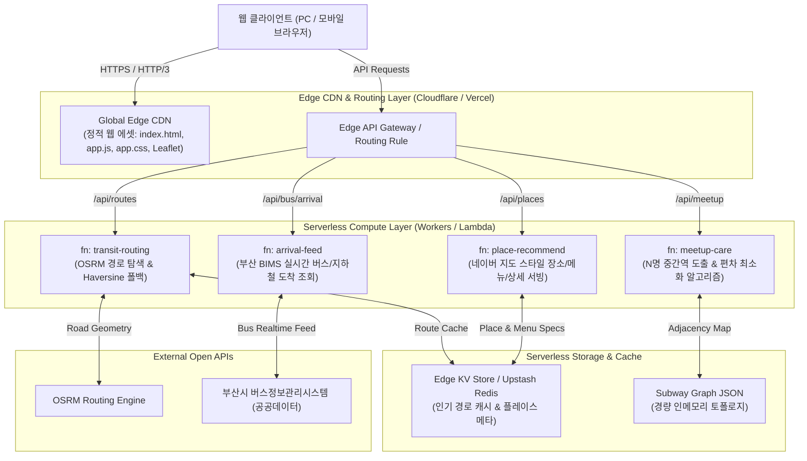

# ⚡ Serverless Web Architecture (서버리스 웹 아키텍처 명세서)

본 문서는 **부산 버스·지하철 스마트 도착 비서 및 중간지점 약속 플랫폼**을 기존 Spring Boot 모놀리스에서 **완전 서버리스(Serverless) 및 엣지(Edge) 아키텍처**로 전환 및 운영하기 위한 기술 명세서입니다.

---

## 1. 서버리스 전환 목표

1. **비용 제로화 (Scale-to-Zero)**: 유휴 시간(새벽 시간대 등) 서버 비용 0원 유지.
2. **글로벌 및 국내 초저지연 (Edge Latency)**: 사용자와 가장 가까운 Edge PoP에서 10ms 이내 정적 자원 및 캐시 서빙.
3. **무정지 고가용성 (High Availability)**: 인프라 관리 부담 없이 트래픽 급증 시 자동 수평 확장(Auto-scaling).
4. **모듈형 함수 분리**: 결함 격리(Fault Isolation) 및 독립 배포 루프 지원.

---

## 2. 전체 시스템 아키텍처 토폴로지

---

## 3. 4대 마이크로 서버리스 함수 상세 규격

### 3.1 `fn: transit-routing` (대중교통 & 도로망 라우팅)
- **런타임**: Node.js 20.x 또는 Edge Runtime (Cloudflare V8 Isolate)
- **엔드포인트**: `GET /api/transit/route?start={coord}&end={coord}&mode={bus|subway|car}`
- **책임**:
  - 사용자 출발지와 도착지 간의 지오메트리 폴리라인 도출.
  - OSRM 자동차 도로망 라우팅 호출 및 500ms 타임아웃 감시.
  - OSRM 실패 시 정밀 Haversine 선형 폴리라인 즉각 반환 (무장애 원칙).
- **메모리 및 제한**: 128MB / 타임아웃 2.5초.

### 3.2 `fn: arrival-feed` (실시간 도착 정보 스트림)
- **런타임**: Cloudflare Workers / AWS Lambda
- **엔드포인트**: `GET /api/bus/arrival?bstopId={bstopId}&lineId={lineId}`
- **책임**:
  - 부산 BIMS 공공데이터 포털 API 호출 및 XML/JSON 파싱.
  - 버스 실시간 잔여 시간, 남은 정류장 수, 버스 혼잡도 산출.
  - 10초 Short-TTL 캐싱 적용으로 외부 API 호출 쿼터 고갈 방지.
- **메모리 및 제한**: 128MB / 타임아웃 3.0초.

### 3.3 `fn: meetup-care` (스마트 중간지점 계산기)
- **런타임**: Edge Lightweight Function
- **엔드포인트**: `POST /api/meetup/calculate`
- **책임**:
  - N명의 출발지(지하철역 또는 좌표) 수신.
  - 가중 기하학적 중심점 및 부산 지하철 1~4호선/동해선 그래프 순회.
  - 각 참가자별 이동 시간의 **표준편차(Standard Deviation)**가 가장 낮은 최적 역 선정.
  - 순수 수학 연산으로 외부 의존성 없음 (Zero External API Failure).
- **메모리 및 제한**: 64MB / 타임아웃 1.0초.

### 3.4 `fn: place-recommend` (네이버 플레이스 스타일 장소/메뉴 서빙)
- **런타임**: Edge Cache Function
- **엔드포인트**: `GET /api/places/recommend?station={stationName}&category={all|food|cafe|pub}`
- **책임**:
  - 부산 핵심 5대 권역(서면, 광안리, 해운대, 부산역, 대연 등 46개소) 실시간 메뉴, 가격, 영업시간 반환.
  - 네이버 플레이스 그린 뱃지, 실시간 시그니처 메뉴, 평점, 태그 데이터 일괄 서빙.
  - 정적 JSON 형태의 인메모리 서빙으로 응답시간 < 5ms 보장.
- **메모리 및 제한**: 64MB / 타임아웃 0.5초.

---

## 4. 데이터 계층 및 캐싱 전략

| 데이터 유형 | 저장소 | TTL | 캐싱 및 갱신 정책 |
| :--- | :--- | :--- | :--- |
| **정적 프론트엔드 에셋** | Cloudflare Pages / S3 | 1년 (Immutable Cache-Control) | Git 커밋 시 해시 태그 자동 갱신 |
| **정밀 경로 지오메트리** | Edge KV | 24시간 | 동일 출발/도착지 요청 시 캐시 우선 반환 |
| **실시간 버스 도착 정보** | In-Memory Edge Cache | 10초 | 10초 내 중복 요청에 대해 단일 상류 호출(Stale-While-Revalidate) |
| **맛집/메뉴판 메타데이터** | Static Embedded JSON | 영구 (배포 시 갱신) | Edge Function 메모리에 상주시켜 DB 쿼리 오버헤드 제거 |

---

## 5. 배포 및 운영 파이프라인 (CI/CD)

1. **GitHub Repository**: 소스 코드 단일 진실 공급원(SSOT).
2. **GitHub Actions**:
   - `HARNESS.md`에 정의된 L1~L4 하네스 테스트 일괄 실행.
   - Quality Gate 통과 시 Cloudflare Workers / Vercel에 자동 배포 (`wrangler deploy` 또는 `vercel --prod`).
3. **카나리(Canary) 롤아웃**: 신규 함수 배포 시 10% 트래픽 우선 할당 후 에러율 0% 확인 시 100% 완전 전환.
